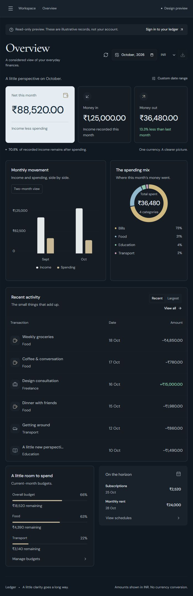
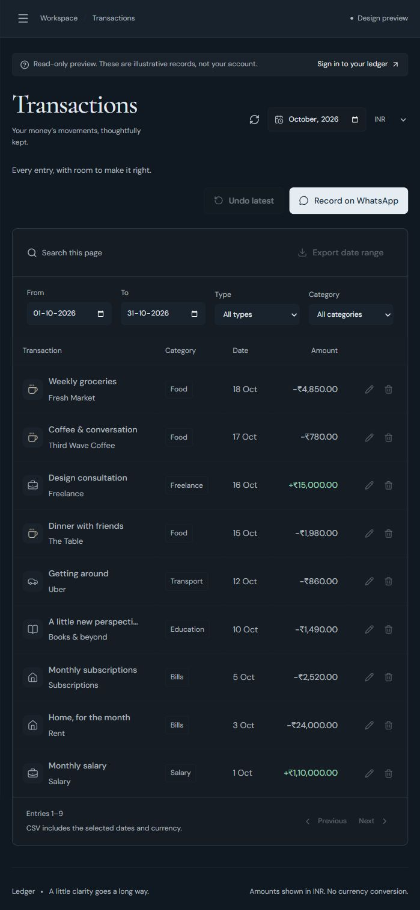
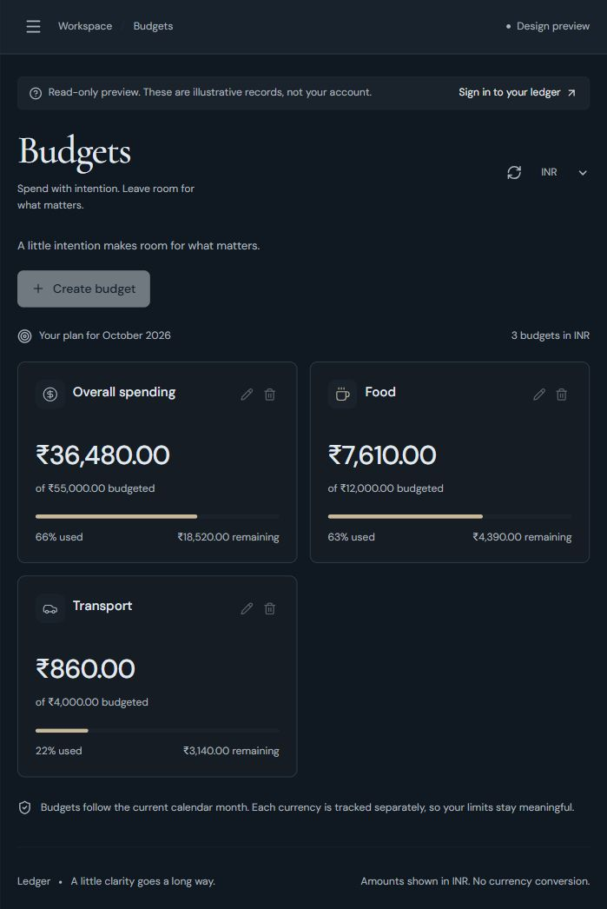
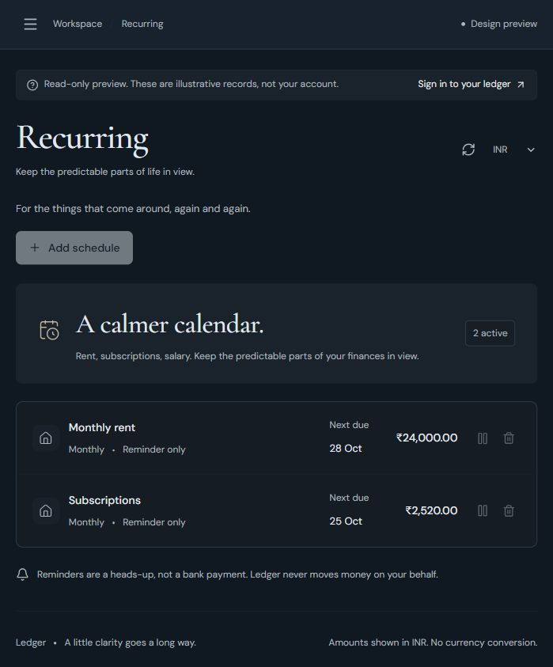
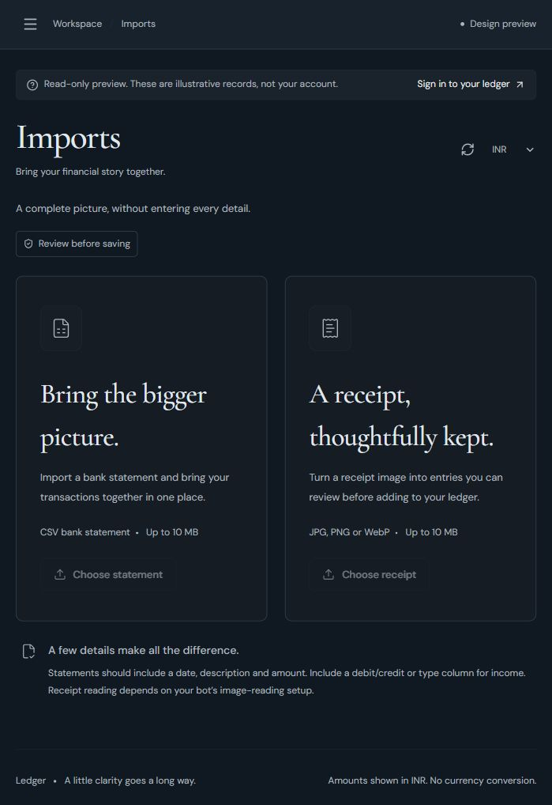
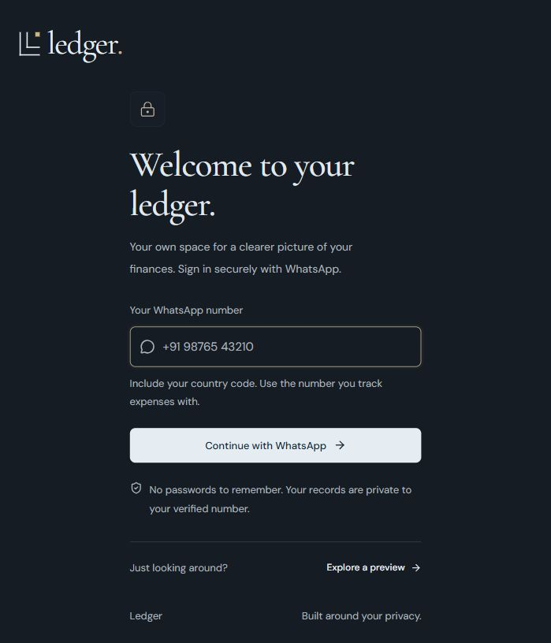
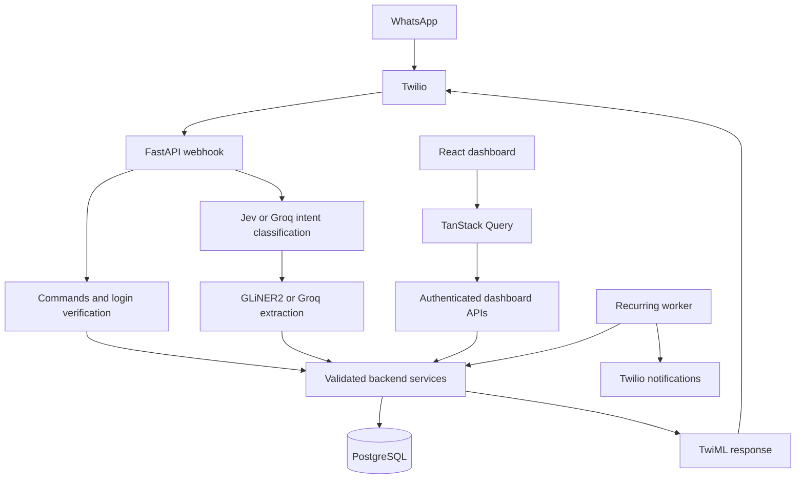

# Ledger · WhatsApp Expense Tracker

**Record it in a message. Understand it in a dashboard.**

A full-stack expense tracker that turns natural-language WhatsApp messages into
structured financial records. Built with **FastAPI, React, PostgreSQL, and
Docker**, Ledger combines conversational entry with a private dashboard for
reviewing transactions, budgets, recurring payments, and spending trends.

```text
You: I spent 250 INR on coffee
You: Received 65000 INR salary
You: How much did I spend this month?
```

[Features](#features) · [Screenshots](#screenshots) · [Quick start](#quick-start-docker) · [Local development](#local-development) · [Architecture](#architecture)

## Features

| Feature | What you can do |
| --- | --- |
| Conversational tracking | Record income and expenses through WhatsApp; ask for totals, category spending, and recent activity. |
| Corrections | Edit an amount, date, or category; delete an entry, undo the latest entry, or cancel an incomplete conversation. |
| Financial overview | Compare months, inspect category spending and largest expenses, and generate reports for custom date ranges. |
| Budgets | Set overall or category budgets per currency and receive alerts when spending reaches 80% or 100%. |
| Recurring entries | Schedule weekly, monthly, or yearly reminders or automatic ledger entries; pause or remove schedules. |
| Bank CSV imports | Preview and edit parsed transactions, review possible duplicates, and select what to import. |
| Receipt imports | Extract transactions from a receipt image through a configured Groq vision model, then review before saving. |
| Private dashboards | Verify your own WhatsApp number to access its records using a browser session. |
| Responsive interface | Review your finances in a dark navy dashboard with charts, filters, pagination, and CSV export. |

Ledger records financial activity. It does not connect to your bank or move money.
Currencies are tracked independently; amounts are not converted between currencies.

## Screenshots

Captured from the running application using its **built-in read-only preview**.
All financial values below are illustrative. Disabled write controls are expected
in preview mode; no personal account or real transaction data was used.

<table>
  <tr>
    <td width="50%" valign="top">
      <strong>Overview</strong><br>
      Monthly income, spending, category breakdowns, and recent activity.
      <br><br>
      <a href="assets/screenshots/overview.jpg"></a>
    </td>
    <td width="50%" valign="top">
      <strong>Transactions</strong><br>
      Date, category, and type filters with transaction review controls.
      <br><br>
      <a href="assets/screenshots/transactions.jpg"></a>
    </td>
  </tr>
  <tr>
    <td width="50%" valign="top">
      <strong>Budgets</strong><br>
      Overall and category limits with progress and remaining balances.
      <br><br>
      <a href="assets/screenshots/budgets.jpg"></a>
    </td>
    <td width="50%" valign="top">
      <strong>Recurring payments</strong><br>
      Due dates, schedules, and reminder or automatic-entry modes.
      <br><br>
      <a href="assets/screenshots/recurring.jpg"></a>
    </td>
  </tr>
  <tr>
    <td width="50%" valign="top">
      <strong>Imports</strong><br>
      Bank CSV and receipt-image upload entry points.
      <br><br>
      <a href="assets/screenshots/imports.jpg"></a>
    </td>
    <td width="50%" valign="top">
      <strong>WhatsApp sign-in</strong><br>
      Verify number ownership without creating a password.
      <br><br>
      <a href="assets/screenshots/sign-in.jpg"></a>
    </td>
  </tr>
</table>

Click a screenshot to view it at full size. To explore the UI yourself, start the
app and select **Explore a preview** on the sign-in screen. Preview mode does not
require WhatsApp verification and cannot modify, import, or export real records.

## Tech stack

| Layer | Technologies |
| --- | --- |
| Frontend | React, Vite, TanStack Query, Lucide React, CSS |
| Backend | Python 3.12, FastAPI, Uvicorn, Pydantic |
| Database | PostgreSQL / Supabase, SQLAlchemy |
| Messaging | Twilio WhatsApp webhook, TwiML responses, outbound notifications |
| Intent classification | Jev through TypeSafe SDK, or Groq |
| Transaction extraction | Local GLiNER2 on CPU, or Groq |
| Receipt reading | Groq vision, when configured |
| Packaging | Multi-stage Docker build, Docker Compose, persistent model-cache volume |

### AI with defined responsibilities

- **Intent classification** decides whether a message records a transaction or asks a question.
- **Field extraction** identifies transaction details, including amount, type, and category.
- **Pydantic validation and backend services** enforce supported values and business rules before persistence.
- **SQL queries** calculate financial totals and reports. The model does not invent balances.
- **Receipt vision** is a separate optional integration; local GLiNER2 is not an image reader.

Explicit correction and budget commands are parsed before general AI routing.

## Architecture



The project is a modular monolith: WhatsApp and the dashboard share the same
service layer and account-scoped database records.

## Quick start: Docker

### Prerequisites

- Git and Docker Desktop with Docker Compose.
- PostgreSQL, such as a Supabase project, with a server-side connection URL.
- A Groq API key for configured Groq paths.
- A Twilio WhatsApp sandbox or configured sender for messaging and real sign-in.
- A TypeSafe API key if using Jev.

### 1. Clone the repository

```bash
git clone https://github.com/yeetcoder777/wp-expense-tracker.git
cd wp-expense-tracker
```

### 2. Create backend configuration

Copy `backend/.env.example` to `backend/.env` and fill in your own values.
For PowerShell:

```powershell
Copy-Item backend/.env.example backend/.env
```

Do this only on a fresh checkout; do not overwrite an existing configured file.

| Variable | Purpose |
| --- | --- |
| `DATABASE_URL` | Server-side PostgreSQL connection URL. Startup needs table-creation privileges for missing tables. |
| `GROQ_API_KEY` | Groq authentication; required by the current Settings schema. |
| `INTENT_CLASSIFIER` | `jev` or `groq`. |
| `TYPESAFE_API_KEY` | Required to use Jev; choose `groq` if not using Jev. |
| `EXTRACTION_PROVIDER` | `gliner2` or `groq` for local Python startup; see the Compose override below. |
| `TWILIO_ACCOUNT_SID` | Twilio account used for outbound messages and reminders. |
| `TWILIO_AUTH_TOKEN` | Twilio authentication and incoming webhook signature validation. |
| `TWILIO_WHATSAPP_FROM` | Your configured bot/sandbox sender, including the `whatsapp:` prefix. |
| `TWILIO_WEBHOOK_URL` | Exact public HTTPS callback ending in `/webhook/whatsapp`. |
| `DASHBOARD_PUBLIC_URL` | Dashboard origin. Leave unset for inferred local development origin, or set the exact deployed HTTPS origin. |
| `GROQ_VISION_MODEL` | Optional actual image-capable Groq model ID for receipt imports. |

Keep credentials in `backend/.env`. It is excluded from Git and Docker image
builds; Compose supplies it at runtime. Never put private keys in `VITE_` variables.

### 3. Start the application

```bash
docker compose up -d --build backend
docker compose logs -f backend
```

Wait for **Application startup complete**, then open:

- Dashboard: **http://127.0.0.1:8000/**
- Health: **http://127.0.0.1:8000/health**
- API documentation: **http://127.0.0.1:8000/docs**

The Docker build compiles React and serves its assets through FastAPI. The first
local-model startup downloads weights and can take longer. The named model-cache
volume persists those downloads.

**Provider override:** the checked-in Compose file explicitly selects GLiNER2,
allows model downloads, and disables Groq extraction fallback. Changing only
`EXTRACTION_PROVIDER` in `.env` does not override that Compose setting. Edit the
service's `environment` block if you intentionally want a different Docker provider.

To stop the app while retaining its named volume:

```bash
docker compose down
```

## Connect WhatsApp

1. Configure your Twilio WhatsApp sandbox or sender. Join the sandbox from your phone when using the sandbox.
2. Expose backend port 8000 with an HTTPS tunnel, for example `ngrok http 8000`, or deploy behind HTTPS.
3. Set Twilio's incoming-message webhook to `https://<your-public-host>/webhook/whatsapp`, using **POST**.
4. Put that exact callback in `TWILIO_WEBHOOK_URL`, configure the Twilio auth token, and recreate the backend after configuration changes.
5. Send a transaction to the bot. Open the dashboard, enter the same WhatsApp number, and send the generated login command to that bot.
6. Keep the original browser tab open while it waits for verification.

Changing `.env` does not change Twilio Console. If a tunnel address changes, update
both the Twilio callback and backend configuration. Use one dashboard hostname
consistently: do not mix `localhost` and `127.0.0.1` during login.

### Example messages

| Action | Message |
| --- | --- |
| Record an expense | `I spent 250 INR on coffee` |
| Record income | `Received 65000 INR salary` |
| Ask for spending | `How much did I spend this month?` |
| Get a summary | `Give me my monthly summary` |
| View recent entries | `Show my recent transactions` |
| Set a budget | `Set my food budget to 8000 INR` |
| Check budgets | `show my budgets` |
| Correct the latest amount | `edit last amount to 300` |
| Delete the latest entry | `delete last` |
| Undo the latest entry | `undo last` |
| Discard an incomplete entry | `cancel` |

Undo removes the latest recorded transaction; it is not a general edit history or
restore operation. For several entries, send one transaction per line.

## Local development

Use Python **3.12** and Node.js **22.12+**. The frontend and backend have separate
source directories and development processes.

### Backend

From the repository root, using PowerShell:

```powershell
python -m venv .venv
.\.venv\Scripts\Activate.ps1
python -m pip install -r backend/requirements.txt
cd backend
python -m uvicorn app.main:app --reload --host 127.0.0.1 --port 8000
```

Configure `backend/.env` first. The merged requirements include local-model
packages. If you already have a configured environment, activate that environment
instead of recreating it. Python settings resolve the backend `.env` by file path.

### Frontend

In another terminal, from the repository root:

```bash
cd frontend
npm ci
npm run dev
```

Open **http://127.0.0.1:5173/**. Vite proxies `/api` requests to backend port 8000,
keeping browser requests on one origin. Do not run another local backend on port
8000 while Docker is already publishing that port.

For a different API port, set `API_PROXY_TARGET` in `frontend/.env.local`.
Optional `VITE_WHATSAPP_NUMBER` contains only the public bot number for a convenience
link. The backend dashboard origin must match the origin used in your browser.

Build frontend assets with:

```bash
npm run build
```

FastAPI selects `frontend/dist` when present at startup, otherwise
`frontend/legacy`. Restart the local backend after first creating the React build.

## Engineering details

- **Caching:** account/resource/filter query keys, five-minute freshness, thirty-minute inactive retention, and invalidation after successful mutations. Manual Refresh picks up external changes; there is no instant WhatsApp-to-browser push.
- **Data isolation:** verified dashboard sessions and server-side ownership filters scope records to the user's WhatsApp identity. Cache cleanup occurs on authentication changes.
- **Webhook handling:** Twilio signature validation and processed-message tracking help prevent spoofed requests and duplicate transaction batches.
- **Money:** backend Decimal and SQL numeric columns provide authoritative arithmetic; JavaScript numbers are used for display and charts.
- **Imports:** previews do not save records. Confirmation imports selected rows and checks possible duplicates using normalized fingerprints and existing records.
- **Recurring work:** an application-lifespan worker checks schedules, with execution records and PostgreSQL row locking to reduce duplicate processing.

## Project structure

```text
.
├── frontend/
│   ├── src/
│   │   ├── api/            HTTP client and error handling
│   │   ├── auth/           WhatsApp login and session state
│   │   ├── components/     Shared UI, charts and transaction tables
│   │   ├── hooks/          Query and mutation hooks
│   │   ├── pages/          Overview, transactions, budgets, recurring, imports
│   │   └── data/           Explicit illustrative preview data
│   ├── public/
│   └── legacy/             Original dashboard fallback
├── backend/
│   ├── app/
│   │   ├── api/            HTTP routes and authentication dependencies
│   │   ├── services/       Commands, extraction and business rules
│   │   ├── db/             Models and database sessions
│   │   ├── schemas/        Validation schemas
│   │   ├── config.py
│   │   └── main.py
│   ├── scripts/            Connection checks, migrations and regression suites
│   ├── .env.example
│   ├── requirements.txt
│   └── Dockerfile
├── assets/screenshots/      README screenshots with illustrative data
├── compose.yaml
└── README.md
```

## Checks and regression scripts

With the backend environment activated, run from `backend/`:

```bash
python scripts/smoke_test_backend.py
python scripts/test_intent_classifier.py
python scripts/test_local_extractor.py
```

The offline suites use simulated provider results and isolated test data. They
are distinct from live WhatsApp, model, or browser verification.

For explicit live checks:

```bash
python scripts/check_whatsapp_connection.py
python scripts/check_intent_classifier.py --strict-jev "How much did I spend this month?"
python scripts/check_local_extractor.py "Spent 250 INR on coffee yesterday"
```

The classifier/model commands may contact their configured providers or download
model files. No test pass counts, coverage percentages, or performance benchmarks
are claimed here.

## Current scope and limitations

- Receipt reading requires a configured Groq vision model; GLiNER2 does not replace it. PDF bank statements are not supported.
- Uploads are limited to 10 MB; bank CSV parsing accepts up to 2,000 rows. Common column aliases are supported, not every bank's custom statement layout.
- CSVs need date, description, and amount or debit/credit columns. Include an explicit type/credit field for income; amount-only rows default to expenses.
- Transaction text search currently filters the loaded page. CSV export supports date and currency filters.
- The recurring worker runs with the application rather than a durable external queue. Reminders do not initiate bank payments.
- Local model inference consumes CPU/RAM; one shared model serializes extraction. Additional API workers load additional model instances.
- Public deployment needs HTTPS, valid Twilio configuration, and a review of existing database permissions. The production privacy guard can stop startup when existing Supabase table access needs review.

## Further reading

- [Frontend setup and behavior](frontend/README.md)
- [Backend configuration and feature reference](backend/README.md)

The repository README is the public entry point. Internal development history and
local notes are kept separately from the user-facing setup instructions.