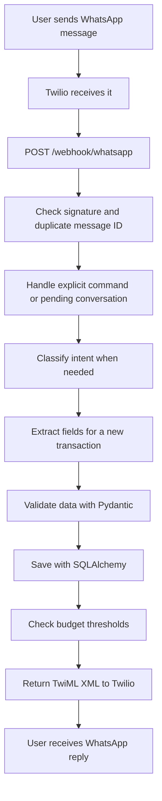

# Expense Tracker: Simple Technical Guide

This guide describes the implementation in `expense-tracker - Copy`.
Jev intent classification is integrated with a configurable Groq fallback.
A TypeSafe API key is needed for Jev. The copy now selects local GLiNER2 for
transaction extraction and category classification; Groq remains selectable.
See section 19 and [the local setup guide](LOCAL_GLINER2.md).

Read sections 1–5 first to understand the application. Then read the feature
explanations and interview examples.

## 1. What does this project do?

Users can record expenses and income by sending WhatsApp messages. They can also
correct entries, set budgets, request reports, import statements and receipts,
and create recurring payment schedules in a browser dashboard.

For example:

```text
User: I spent ₹250 on coffee
Bot: Recorded INR 250.00 spent for coffee. #12
```

The useful part is that the user can write a normal sentence instead of filling
out a form. The backend turns that sentence into a validated database record.

**A short interview introduction:**

> I built a WhatsApp expense tracker with a web dashboard. FastAPI handles the
> requests, Jev routes messages, local GLiNER2 extracts transaction fields, and SQLAlchemy saves data
> in a relational database. I added transaction corrections, budgets, reports,
> recurring payments, and reviewed imports. I focused on validation, keeping
> users' records separate, and preventing duplicate writes when messages retry.

## 2. The technology stack

| Technology | Simple explanation | Its role here |
| --- | --- | --- |
| Python | The language running the backend | Services, validation, imports, scheduling |
| FastAPI | Receives HTTP requests and sends responses | WhatsApp webhook and dashboard APIs |
| Uvicorn | Runs the FastAPI application | Development/application server |
| Pydantic | Checks that data has the expected structure | Validates amounts, dates, types, lengths |
| SQLAlchemy | Maps Python models to database tables | Queries, sessions, database transactions |
| PostgreSQL | A relational database | Supported application storage |
| SQLite | A lightweight database | Temporary storage for automated tests |
| Twilio | Connects WhatsApp to the backend | Incoming messages, replies, notifications |
| Groq API | Runs the configured AI model | Intent classification and data extraction |
| Jev / TypeSafe SDK | Chooses a fixed intent label | Routes natural-language requests |
| GLiNER2 / PyTorch / Transformers | Runs a small encoder locally | Transaction entities and category/type classification |
| HTML, CSS, JavaScript | The browser interface | Dashboard forms, tables, spending bars |
| Fetch API | Sends browser HTTP requests | Dashboard calls to the backend |
| asyncio | Runs background work during app lifetime | Recurring schedule polling |
| ngrok | Gives a local server a public address | Twilio integration during development |
| unittest and TestClient | Run automated checks | Regression tests with an isolated database |

The dashboard uses plain JavaScript and HTML/CSS spending bars.
The database connection is configured through `DATABASE_URL`. A PostgreSQL host
such as Supabase can provide the database; the code uses SQLAlchemy rather than
Supabase's authentication or client SDK.

## 3. Follow one message through the system



This diagram shows the new-transaction path. An explicit command or an answered
query can return a reply earlier without running all subsequent steps.

Three terms to understand:

- **Webhook:** Twilio calls our URL when a message arrives. Our app does not keep
  asking Twilio whether there is a new message.
- **API endpoint:** A URL and HTTP method that perform a particular operation.
  For example, `POST /webhook/whatsapp` accepts a WhatsApp event.
- **TwiML:** XML instructions returned to Twilio, telling it which reply to send.

An HTTP `200` means the webhook returned a response. Check the response text as
well: the app can return `200` with a message explaining that processing failed.

## 4. Classification and extraction are different

This is the most important distinction in the AI part of the project.

**Classification picks a label.**

```text
Input:  I spent ₹250 on coffee
Output: transaction

Input:  How much did I spend this month?
Output: month_total
```

The label tells the backend which operation the user wants. The current function
is `detect_intent()` in `app/services/llm_service.py`.

**Extraction finds the actual values in the message.**

```json
{
  "transaction_type": "expense",
  "amount": 250,
  "currency": "INR",
  "purpose": "coffee",
  "category": "food"
}
```

The public function is `extract_transactions()` in `llm_service.py`; it delegates
to `transaction_extraction_service.py` to select the local or Groq implementation.

**Validation checks the extracted values.** Pydantic checks rules such as a
positive amount, at most two decimal places, and an allowed transaction type.
Valid structure alone cannot prove that the model understood the sentence.

**Business logic performs the operation.** Python and SQL calculate reports,
check budgets, and save or update records. Those operations are controlled by code.

In the current implementation, classification can use Jev or Groq.
Transaction extraction can use GLiNER2 or Groq. Existing category/time-range
query parsing still uses its existing Groq paths.
Predictable commands such as `cancel` and `edit last amount to 300` use ordinary
Python and regular expressions before intent classification.

## 5. Jev integration: classification only

**Jev is now integrated.** It chooses among the existing 21 supported intent labels.
It uses TypeSafe's Choice interface; see the [official documentation](https://docs.typesafe.ai/primitives/choice).

For example, Jev can classify "How much did I spend this month?" as `month_total`.
The SQL report service then calculates the actual spending.

```text
Incoming message
    |
    +-- Explicit command / pending answer -> existing Python handling
    |
    +-- Otherwise -> configured classifier
                       |
                       +-- Jev: choose a supported intent and check confidence
                       |     |
                       |     +-- Missing key / error / low confidence -> Groq fallback
                       |          (or unknown when fallback is disabled)
                       |
                       +-- Report intent -> SQL/service -> formatted reply
                       |
                       +-- Transaction intent -> GLiNER2 or Groq extracts fields
                                                -> Pydantic -> database
```

Three new pieces of code make this possible:

- `intent_registry.py`: defines the supported labels and their descriptions.
- `intent_classifier_service.py`: calls Jev or Groq, validates results, and decides fallback.
- `check_intent_classifier.py`: checks one real classification without saving records.

The existing `detect_intent()` function now delegates to that service. It still
returns the label string expected by the webhook. The original Groq classifier
is retained as `detect_intent_groq()`. This keeps provider selection separate
from transaction saving and report calculation.

Jev calls use the official `typesafe-sdk`, model `jev-1.14.0` by default,
a configurable HTTP-operation timeout, and no SDK retries. The webhook dispatches
classification and transaction extraction to a thread pool so synchronous model
calls do not block its async event loop. Synchronous database work and other
query parsing still need future concurrency improvements.

Configure the copy folder's `.env`:

```dotenv
INTENT_CLASSIFIER=jev
TYPESAFE_API_KEY=your_typesafe_key
JEV_MODEL=jev-1.14.0
JEV_TIMEOUT_SECONDS=4
JEV_MIN_CONFIDENCE=0.6
JEV_FALLBACK_TO_GROQ=true
```

The integration initially added an empty key field. The user has since verified
a real strict-mode Jev call successfully. For another setup, fill the field locally with
a key from the [TypeSafe console](https://console.typesafe.ai/) and restart the
backend. Until a key is supplied, the configured fallback continues classification
with Groq. `INTENT_CLASSIFIER=groq` selects the original provider directly.

Type-safe results can still choose the wrong intent. Confidence is not a promise
of correctness. The minimum of 0.6 is an initial configurable policy, not a
threshold validated against this application's messages. See
[confidence guidance](https://docs.typesafe.ai/confidence).

To prevent automatic fallback, set `JEV_FALLBACK_TO_GROQ=false`. Unavailable or
uncertain Jev decisions then route to `unknown`, producing guidance rather than
saving a new transaction based on that decision. Both providers' labels are
checked against the registry.

For a real classification check that cannot silently use Groq:

```powershell
python scripts/check_intent_classifier.py --strict-jev "How much did I spend this month?"
```

This sends the supplied text to the provider and prints the label, provider,
confidence, and fallback reason. It writes no transaction records. The user verified real Jev account access on 17 October 2026: the monthly
spending query returned `month_total`, provider `jev`, confidence `1.0`, and no
fallback. This verifies one successful classification, not overall accuracy. Automated tests use simulated responses through
the actual SDK transport, and verify fallback and webhook behavior.

Before relying on the classifier, compare both providers on held-out English,
Hinglish if relevant, typo-heavy, ambiguous, and multi-entry messages. Measure
wrong routes, latency, and cost. No improvement figures are claimed for this app.

**Interview explanation:**

> I separated intent classification from field extraction. Jev uses typed Choice
> labels to select the user's intent. I validate its label and check confidence,
> with a configurable Groq fallback on errors or uncertainty. Local GLiNER2 now
> extracts transaction fields and categories, and ordinary Python and SQL handle
> financial calculations and persistence.

## 6. How the code is organized

```text
app/
  api/       Receives requests; performs HTTP-related handling
  schemas/   Defines valid request and transaction shapes
  services/  Applies transaction, report, budget, and scheduling rules
  db/        Defines tables, connections, and sessions
  static/    Contains the browser dashboard
scripts/     Contains regression tests and connection checks
```

This is a **modular monolith**: one application organized into focused modules.
For example, WhatsApp and dashboard routes reuse transaction services instead
of each implementing their own database rules.

The design uses separation of concerns: a receipt parser should not need to
know how to render dashboard HTML. Services currently query SQLAlchemy directly;
there is no separate repository layer.

## 7. Editing, deleting, undoing, and cancelling

```text
edit 12 amount to 300
edit 12 date to 2026-10-17
edit 12 category to food
delete 12
undo last
```

The code finds the record using both its ID and the requesting user's identity.
That prevents another user from editing a record just by guessing its ID.

`undo last` deletes the latest transaction. The implementation does not maintain
a history that can reverse arbitrary edits or restore deleted records.

For missing information:

```text
User: Spent ₹100
Bot: What was the purpose?
User: Tea
```

The database stores the partial transaction and the field being requested.
This is a small **state machine**: waiting for a purpose, then completed or
cancelled. Database persistence lets the state survive a restart. It expires
after 24 hours. Commands are checked before the pending answer, so `cancel`
clears the state rather than becoming the expense purpose.

## 8. Multiple transactions and duplicate protection

The user can send:

```text
I spent ₹250 on coffee
Received ₹65000 salary
```

The extractor normalizes supported JSON shapes into a list, then validates each
transaction. If every item is complete, all entries and the message marker are
saved in one database transaction. If a batch needs more details, the bot asks
the user to send entries separately; it does not silently save only the first.

A **database transaction** means a group of writes succeeds together or rolls
back together.

Twilio can retry a webhook. The backend stores its unique `MessageSid` in
`processed_webhooks`, then checks that marker on repeated delivery. Repeating
the same event should not create more transaction records. This property is
called **idempotency**.

The database's unique message ID also helps when two requests arrive together.
Application checks alone could let both requests pass before either writes.

Current limitation: explicit edit/delete commands claim their message marker
before executing the update. A crash between those steps could leave a command
marked processed without completing it. Making those writes atomic is a future
reliability improvement.

## 9. Budgets and alerts

```text
Set my food budget to ₹1000
```

The backend adds up the user's food expenses in the current month and currency:

```text
percentage used = spending / budget * 100

₹800 / ₹1000 * 100 = 80%
```

It reports the 80% and 100% thresholds and stores which ones have triggered.
A unique constraint on `(budget_id, period_start, threshold)` helps prevent the
same threshold from being recorded twice in the month.

Think of a **unique constraint** as a database rule that rejects duplicate keys.
The alert record and delivery are separate operations, so a recorded threshold
does not guarantee that an external WhatsApp notification was delivered.

## 10. Reports and money handling

The database uses `SUM` to add amounts, `GROUP BY` to produce category totals,
date filters to select periods, and sorting plus a limit for largest expenses.

```text
net balance = income - expenses
savings rate = net balance / income * 100
month change % = (current spending - previous spending) / previous spending * 100
```

Zero denominators need explicit handling. Currently, savings rate is zero when
income is zero; expense change percentage is absent when previous spending is zero.

Money is stored as database `NUMERIC(12, 2)` and handled with Python `Decimal`.
Decimal arithmetic avoids the binary rounding surprises associated with floats.

Currencies stay separate because adding ₹100 and $100 does not produce a useful
single total without an exchange-rate policy. Currency conversion is not implemented.

Indexes on `(user_id, transaction_date)` and `(user_id, created_at)` help the
database locate common date-range and recent-record queries. An index speeds
appropriate lookups but adds storage and write overhead.

## 11. The web dashboard

The dashboard uses HTML, CSS, and plain JavaScript. JavaScript calls the backend
with `fetch()`, receives JSON, and updates tables, forms, and spending bars.
It provides report filters, transaction corrections, CSV export, imports, and
recurring schedule controls.

The API uses familiar HTTP operations:

| Method | Meaning here | Example |
| --- | --- | --- |
| GET | Read data | List transactions |
| POST | Create or trigger an operation | Save a budget or confirm an import |
| PATCH | Change selected fields | Correct an amount |
| DELETE | Remove a record | Delete a transaction |

The dashboard sends a bearer token in the `Authorization` header. The backend
checks it with `hmac.compare_digest` and binds requests to `DASHBOARD_USER_ID`.
The browser stores the token in session storage.

This is a simple dashboard for one configured account. Registration, JWT login,
role permissions, and a full multi-user account system are future improvements.

## 12. Recurring payments and reminders

Example: record rent every month, or remind the user before it is due.

An `asyncio` task starts with FastAPI and checks schedules every minute.
The worker sends an eligible reminder or records an automatic transaction,
stores the execution, and advances the next due date. Synchronous worker work
is dispatched using `asyncio.to_thread`.

Monthly schedules preserve their intended day. A payment anchored to the 31st
can use February's final day and return to the 31st in a later month.

PostgreSQL `FOR UPDATE SKIP LOCKED` lets a worker lock a schedule while another
worker skips it. A unique schedule/date execution record adds another check.
SQLite does not provide equivalent row-lock behavior, so use one app worker there.

The worker is part of the application process. It runs only while that process
is alive; it is not a durable external job queue. Dedicated workers, delivery
retries, and an explicit missed-payment policy would improve production behavior.

## 13. Bank statements and receipt imports

The workflow is:

```text
Upload -> Parse/extract -> Validate -> Preview -> User reviews -> Confirm -> Save
```

**CSV:** Python's CSV parser recognizes common date, amount, description, debit,
and credit columns. Rows are normalized, validated, and checked for duplicates.
Bad rows can be shown for correction instead of silently becoming transactions.

**Receipts:** A configured Groq vision model interprets the uploaded image and
returns transaction fields. It is not a separate Tesseract OCR implementation.
Review is required because extraction can misread amounts or receipt items.

For duplicate detection, the code normalizes transaction fields and creates a
SHA-256 fingerprint. A fingerprint is a compact identifier for comparison; it
does not encrypt the transaction. The importer also checks existing records.

Identical legitimate purchases may be flagged, while descriptions that differ
can evade matching. These are possible duplicates, which is why the preview matters.

## 14. Testing: what the 40 tests prove

Run from the copy folder:

```powershell
cd "D:\Siddhesh\Projects\expense-tracker - Copy"
.\venv\Scripts\Activate.ps1
python scripts/smoke_test_backend.py
```

The tests exercise the real FastAPI handlers using TestClient and a temporary
SQLite database. They check replies and saved records for entries, corrections,
budgets, queries, imports, reports, recurring execution, signatures, and retries.

**Mocking** replaces an external dependency with a controlled test response.
Here, model results are simulated so tests run repeatably without provider calls.

For example, a test supplies two extracted transactions, sends the webhook twice
with the same message ID, and verifies that the database still contains two rows.

These tests do not establish real Groq/Jev classification quality, actual WhatsApp
delivery, PostgreSQL locking behavior, or receipt image recognition accuracy.
Those require additional integration checks and evaluation data.

The expanded suite includes 15 classifier tests and two new webhook tests, in
addition to the previous 23 regressions. It checks the real TypeSafe SDK against
a fake HTTP transport, confidence thresholds, invalid responses, API failures,
strict mode, and continued Groq extraction after Jev routing.

The project was developed iteratively with regression checks. It was not built
using strict test-driven development, where tests always precede implementation.

## 15. What we learned while debugging

| Symptom | What it taught us |
| --- | --- |
| A list failed single-transaction validation | Normalize model output shapes, then validate every item |
| The database driver could not import | Make driver selection match installed dependencies |
| Edits seemed to have no effect | Verify which folder and Python process are serving requests |
| ngrok showed zero incoming connections | Check Twilio callback configuration and sender/Sandbox membership |
| No application log before a rejected request | Log arrival in middleware before signature/form validation |

To debug delivery, follow the actual request path:

```text
WhatsApp -> Twilio -> public ngrok URL -> localhost port -> route -> services -> database
```

`TWILIO_WEBHOOK_URL` in `.env` supports signature verification. It does not update
Twilio's saved callback; that must be configured on the correct sender/Sandbox.

## 16. Interview vocabulary in plain English

| Term | Meaning in this project |
| --- | --- |
| Modular monolith | One deployable app with focused internal modules |
| Separation of concerns | Keep HTTP handling, validation, and financial rules in appropriate modules |
| ORM | Map Python objects to relational tables and queries |
| Database session | Manages database operations during a request or worker operation |
| Database transaction | Commit a group of writes together or roll them back |
| Atomicity | The grouped operation is applied completely or not applied |
| Idempotency | Repeating the same event does not create additional intended effects |
| State machine | Track which conversation step the user is answering |
| Constraint | A database rule enforcing valid or unique relationships |
| Dependency injection | FastAPI supplies a database session or authenticated identity to an endpoint |
| Regression test | Checks that a previously working behavior still works |
| Classification | Choose the user's intent from known labels |
| Extraction | Find fields such as amount, date, category, and purpose |

## 17. Interview practice answers

**Explain the architecture.**

> It is a modular monolith. FastAPI routes accept WhatsApp and browser requests.
> Pydantic validates data, services apply business rules, and SQLAlchemy handles
> storage. The two interfaces reuse the same services.

**Explain the AI's role.**

> The AI interprets natural-language input. I validate its output before using
> it, and ordinary Python and SQL perform the financial calculations and writes.

**Explain duplicate protection.**

> Twilio can retry messages. I store the MessageSid and use a database uniqueness
> rule so repeated delivery does not insert the same transaction batch again.

**Explain a difficult bug.**

> One message contained both a coffee expense and salary income. The model
> returned a list, while the backend expected one object. I normalized response
> shapes, validated every item, and added a regression test for batches and retries.

**Explain what you would improve.**

> I would add Alembic database migrations, account authentication, dedicated
> background workers, and durable notification retries. I would also make command
> updates and their message markers atomic, and evaluate real model accuracy.

## 18. Honest boundaries and next steps

- Jev classification is implemented; actual Jev calls require a TypeSafe key. Local GLiNER2 handles transaction extraction when selected; Groq supports the original extraction and optional fallback.
- Deletion is permanent; undo currently removes the latest transaction.
- Dashboard access uses one configured user's bearer token.
- Background scheduling depends on the backend process being alive.
- Tables are created at startup; existing schema changes need migrations.
- Model output validation checks structure and rules, not factual understanding.
- Notification delivery and processing do not have an exactly-once guarantee.
- Synchronous database/model calls inside the async webhook can limit concurrency;
  an async implementation or background processing would need deliberate design.

First practice the message flow and the classification/extraction distinction.
Then explain one feature using its input, validation, database change, and output.
Finally, explain one failure case and the test or constraint that addresses it.

## 19. How local GLiNER2 works

Think of Jev as choosing **which operation** to perform and GLiNER2 as selecting
**which words contain the transaction's data**. For `Spent 250 INR on coffee`,
GLiNER2 identifies an amount span (`250 INR`) and a purpose span (`coffee`), and
classifies the type as expense and the category as food.

The code checks that each extracted span matches the original message, parses
money using `Decimal`, resolves dates deterministically, and validates the final
`Transaction` with Pydantic. A small amount of date/currency parsing uses regular
expressions. SQLAlchemy and the existing services still own database writes.

This is **zero-shot schema-based extraction**, not a model trained on our expense
data. Labels and descriptions guide a pretrained 205M parameter encoder. It runs
on CPU through `gliner2.AutoExtractor`, PyTorch, and Transformers, with model
weights downloaded from Hugging Face at a pinned revision.

`local_extraction_service.py` owns model loading, schemas, source checks, and
normalization. `transaction_extraction_service.py` owns provider selection and
fallback. The API continues calling the same public extraction function.
This keeps ML dependencies separate from the rest of the app.

The model loads once at startup and is reused. Inference runs outside the async
event loop; a lock prevents simultaneous use of the shared model. This favors a
simple local deployment, but serial inference limits throughput.

One warm coffee extraction took about 538 ms; cold loading took about 20 seconds.
Those are observations from one example, not an accuracy or speed comparison
against Groq. Real Jev plus GLiNER2 webhook tests passed for coffee and a two-line
coffee/salary batch, using a temporary database and checking duplicate retries.
There are 19 additional local regression tests alongside the existing 40.

The app still needs network access for Twilio, Jev, the hosted database, and
other configured Groq paths. Local extraction does not make the whole app offline.
Use explicit numeric amounts and one transaction per line; ambiguous entries
are declined when local fallback is disabled. Read [LOCAL_GLINER2.md](LOCAL_GLINER2.md)
for installation, real test commands, configuration, and current limitations.

## Official Jev references

Checked on 17 October 2026. The classifier integration has offline regression
coverage and one successful live strict-mode classification reported by the user.
Application-specific accuracy and performance have not been benchmarked.

- [TypeSafe introduction](https://docs.typesafe.ai/introduction)
- [Choice questions](https://docs.typesafe.ai/primitives/choice)
- [Intent routing](https://docs.typesafe.ai/patterns/intent-routing)
- [Confidence and probabilities](https://docs.typesafe.ai/confidence)
